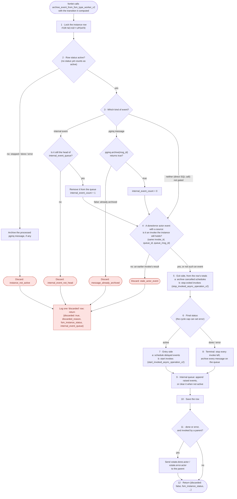

# SPEC-011: Stop Invokes and Child FSMs When Their State Exits

| Field   | Value                                                                                                                                                                                     |
| ------- | ----------------------------------------------------------------------------------------------------------------------------------------------------------------------------------------- |
| Status  | Implemented                                                                                                                                                                               |
| Date    | 2026-10-20                                                                                                                                                                                |
| Authors | Niraj, Claude (Opus 5.5)                                                                                                                                                                  |
| Issue   | #514                                                                                                                                                                                      |
| Affects | `packages/database-src`, `packages/fsm-sync-worker-ts`, `packages/fsm-core-db-ts`, `packages/fsm-async-worker-gateway-ts` (one call switched to the new finish function), `test-apps/e2e` |

Database half of #514. Its counterpart is
[SPEC-012](spec-012-cancel-inflight-actor-invoke.md), which makes the Activity
Gateway and the worker SDKs stop a running actor handler and builds on this
spec. This spec needs nothing from SPEC-012 and ships first.

Related: #532 (a child FSM's error event carries its context; step 11's
payload), #512 (the cancel notification's fixed channel), #510 (a late actor
result is consumed with no change), #523 / #526 (invoked child FSMs are real
instances, started through `start_invoked_async_operation_v2`), #396 (retriable
failures are redelivered), SPEC-010 (internal event queue).

---

## Problem

When a state exits, `archive_event_from_fsm_type_worker_v2` step 4 handles every
stopped invoke the same way: it calls
`cancel_event_for_fsm_async_operation_type_worker_v2`, which archives the
invoke's start message with `pgmq.archive` and notifies
`fsm_async_operation_cancel` with `{"queue_name", "msg_id"}`. That is wrong for
child FSMs, and for actors it leaves a race in the database itself. (Stopping an
actor handler that is already running is SPEC-012.)

**Actors (`internalAsyncOperation`, `sharedAsyncOperation`): a late result still
reaches the parent.** A message handed to a worker is still in its queue (the
gateway claims with a visibility timeout), so the cancel's archive succeeds
while the worker keeps going. Its result then reaches
`archive_event_from_fsm_async_operation_type_worker_v2`, whose `pgmq.archive`
returns false but which still sends `xstate.done.actor.*` to the parent. Since
#510 the parent consumes it with no change. The two functions each act whatever
the archive returned: a completion that won the race doesn't stop the cancel
from notifying either.

**Child FSMs (`fsm`).** Step 4 sends a child FSM through the same actor cancel
function. That archives the child's start event if it is still queued. It also
writes the cancel row into the wrong table
(`fsm_async_operation_queue_event_logs`, keyed by the child's id) and fires
`fsm_async_operation_cancel`, which means nothing for an FSM. A child that has
already started keeps running, along with its own actors, children and delayed
events. When it finishes, archive step 9 sends `xstate.done.actor.<invoke id>`
to the parent, as for a late actor result. `start_child_fsm_v2` already notes
"Stopping a child that is already running is a follow-up (#514)".
`stop_event_for_fsm_worker_v2` doesn't fill the gap: it only deletes
`pending`/`scheduled` dispatch rows. It doesn't mark the instance stopped, so
the child is dispatched again as soon as its next event arrives.

**A stale result can be taken for a new invoke's result.** When the invoking
state is entered again, a new actor or child is started under the **same invoke
id**, as XState does. The parent matches results by name alone
(`xstate.done.actor.<invoke id>`). If the old invoke's completion commits before
the parent's exit, its done event is already in the parent's queue. The parent
exits, re-enters, starts a new invoke X, then reads the stale `done.actor.X` and
treats the **new** invoke as finished.

**The macrostep save can't stop safely.**
`archive_event_from_fsm_type_worker_v2` is where every one of the fixes above
has to take effect, and today it can't support them:

1. **It takes its row lock late.** The first `FOR UPDATE` is at step 6b, after
   steps 1–6 have archived schedules, cancelled invokes and started new ones.
   Those steps work on `input_total_*_queue_data`, the totals the fsmlet read
   earlier, and step 7 writes values derived from them back over the row. A stop
   that lands while a macrostep is in flight can't be seen in time, and step 7
   then overwrites the totals the stop cleared.
2. **A terminal status leaves invokes and schedules running.** When the saved
   status is `done` or `error`, entries left in the totals keep running. The
   internal-event cycle cap sets `error` only after step 6 has already started
   this macrostep's invokes. XState stops all of an actor's children when it
   finishes or fails. (`pgfsmctl instance stop` has the same gap: it only
   removes the dispatch row.)
3. **Step 8 ignores `pgmq.archive`'s result.** If the processed message was
   already archived (a redelivery after its visibility timeout, or a stop), the
   macrostep has been applied a second time. Steps 3 and 4 also ignore their
   archive results and always report success.
4. **The internal-event head check raises.** A stop clears
   `internal_event_queue`, so a macrostep racing it hits the "not the head"
   `RAISE` instead of being discarded.
5. **The lock mode can deadlock against a child.**
   `fsm_instance_queue_event_logs.fsm_instance_id` is a foreign key to
   `fsm_instance`, so inserting a parent's log row takes `FOR KEY SHARE` on the
   parent row, which conflicts with `FOR UPDATE`. A child's archive holds the
   child row and, in step 9, waits for the parent row to log the notification.
   At the same time, the parent's archive holds the parent row and waits for the
   child row to stop it. Postgres detects the deadlock and aborts one of them.

Who is affected: any FSM whose invokes can still be running, or finishing, when
their state exits or is re-entered. That includes every `after` timeout racing
an invoke (#516), and every invoked child machine.

## Constraints

- **XState semantics.** Stopping an actor stops its whole subtree and cancels
  its delayed events. A stopped actor sends its parent nothing. Re-entering a
  state starts a fresh actor under the same invoke id.
- **Lock order.** The parent's archive holds the parent row and then works on
  its children. Anything a child does must not take a lock on the parent row
  that conflicts with the parent's, or the two can deadlock. A child does
  implicitly take `FOR KEY SHARE` on the parent: every event-log insert for the
  parent checks its foreign key. So instance rows must be locked
  `FOR NO KEY UPDATE`, which doesn't conflict with `FOR KEY SHARE` and is what a
  plain `UPDATE` of non-key columns takes anyway, never `FOR UPDATE`.
- **Delivery stays at least once** (#396). This spec makes each FSM message
  apply exactly once and keeps stale results out. It doesn't change actor
  delivery.
- **The deprecated v1 worker** (`fsm-async-worker-ts`) still calls the two actor
  functions by name, and must keep working without changes.

## Options considered

### 1. Finishing an actor message: completion and cancel

**A. Keep two functions.**
`archive_event_from_fsm_async_operation_type_worker_v2` (completion) and
`cancel_event_for_fsm_async_operation_type_worker_v2` (cancel) each do their
side effects whatever `pgmq.archive` returned. A cancel and a completion racing
on one message both act: the late result is sent to the parent (relying on #510
to discard it), and a `Cancel` is sent to a worker that has already finished.

**B. One function, gated on `pgmq.archive`.** A single function takes the reason
(`completed` or `cancelled`) and does its side effects only when its own
`pgmq.archive` returned true. `pgmq.archive` deletes the message row, so two
transactions racing on one message serialise on its row lock, and exactly one of
them wins. Costs a signature change (`DROP` + `CREATE`) and a schema migration.

### 2. Stopping a child FSM

**A. Call `stop_event_for_fsm_worker_v2`.** Already exists. But it only deletes
pending dispatch rows: a running child keeps running, is dispatched again on its
next event, isn't marked stopped, and its own invokes and delayed events
continue.

**B. A new `stop_child_fsm_v2`.** Marks the child stopped, clears its queue and
dispatch, stops its invokes recursively, and the child's archive discards any
macrostep saved after the stop. More code, but it is what XState's stop means.

### 3. Rejecting a stale done/error event from an earlier invoke

**A. Child-side check in archive step 9.** Before notifying, the child locks the
parent row (`FOR SHARE`) and checks that the parent still holds this child.
Covers only the case where the parent's exit commits first. It locks child, then
parent, against the parent archive's parent-then-child order, so it can
deadlock. And it does nothing for actors.

**B. Parent-side check on the event's source.** Every `xstate.done.actor.*` /
`xstate.error.actor.*` event carries the invoke it came from. The parent drops
the event when its current entry for that invoke id doesn't match. Covers both
commit orders, takes no extra lock, and treats actors and child FSMs alike.

### 4. Making the macrostep save safe

**A. Patch the guards into today's order.** Add a `stopped` check after the 6b
lock, and check step 8's archive result. Smallest diff, but the lock still comes
after the invokes have started. The totals still come from the caller, and the
cycle cap still flips the status after the starts. Each guard would be working
around the order rather than relying on it.

**B. Reorder the whole function.** Lock first (`FOR NO KEY UPDATE`), gate on
status and on the processed message before any side effect, work from the row's
totals, decide the final status before the entry side, and stop the subtree on a
terminal status. A rewrite of one function, but every guard then holds by
construction.

## Decision

**Finishing an actor message: 1B (one function, gated).** Driver: the race
between a cancel and a completion is resolved in the database, by the row lock,
instead of by every consumer downstream. Cancel wins: the late result is never
sent to the parent. Completion wins: no `Cancel` is sent to a finished worker.
1A loses because both sides act and the consumers have to clean up.

**Stopping a child FSM: 2B (`stop_child_fsm_v2`).** Driver: XState semantics. A
stopped child stops its subtree and never reports back. 2A loses because a
running child carries on.

**Stale events: 3B (parent-side source check).** Driver: it is the only option
that covers both commit orders and both kinds of invoke. 3A loses on coverage,
and on lock order.

**Macrostep save: 4B (reorder).** Driver: the stop, the stale-event check and
exactly-once processing all need the same thing: to be decided under the lock,
before any side effect. 4A loses because the lock would still come after the
starts. See "Target sequence" below.

## Design

### `finish_async_operation_event_v2` (replaces the two actor functions)

```
fsm_core.finish_async_operation_event_v2(
    input_archive_reason text,          -- 'completed' | 'cancelled' (CHECK)
    input_async_operation_queue_name text,
    input_async_operation_queue_msg_id bigint,
    -- completion only, DEFAULT NULL:
    input_event_name, input_event_action_type, input_event_output,
    input_send_to_parent_queue_id, …, input_event_status, input_error_message,
    input_execution_started_at, input_execution_duration, input_execution_finished_at
) RETURNS jsonb
```

1. `archived := pgmq.archive(queue, msg_id)`.
2. If `archived`:
   - `completed`: if `input_send_to_parent_queue_id` is a real parent (the
     existing system-queue checks), send the result with
     `send_event_to_fsm_queue_with_event_logs_v2`. The message carries the
     event's **source**, `{invoke_id, queue_id: <queue name>, queue_msg_id}`
     (see "Stale done/error events"). `completed` means "the worker finished",
     whether it succeeded (`xstate.done.actor.*`) or failed
     (`xstate.error.actor.*`, including the archive after the last delivery
     attempt).
   - `cancelled`:
     `pg_notify('fsm_async_operation_cancel', {"queue_name",
     "msg_id"})`,
     delivered when the transaction commits.
3. Always write one `fsm_async_operation_queue_event_logs` row. Its
   `event_status` is the outcome (`succeeded` / `failed` / `canceled`) when
   `archived`, and `discarded` when not, with the reason in `event_data`. A
   dropped late result stays visible.
4. Return `{archive_result, reason, status, …}`.

The gateway calls it with `completed`, and `stop_invoked_async_operation_v2`
with `cancelled`. Of the two old functions:

- `cancel_event_for_fsm_async_operation_type_worker_v2` is **dropped**. Nothing
  else called it, and no role was granted it.
- `archive_event_from_fsm_async_operation_type_worker_v2` stays for one release
  as a thin wrapper, marked deprecated. A gateway deployed before #533 calls it
  by name, as do the deprecated v1 worker (`fsm-async-worker-ts`, `.ts` and
  `.py`) and `@pgfsm/db`'s `archiveEventFromFsmAsyncOperationTypeWorker`.
  Removing it is #548.

The schema file is `20250219134752_finish_async_operation_event_v2.sql` (renamed
from `…_archive_from_async_operation_worker_v2.sql`). This is a schema change:
follow `docs/schema-change-propagation.md` (types, `fsm-core-db-ts`'s
`asyncOperationCtl.ts`, the gateway's `asyncOpPollLoop.ts`,
`test-apps/e2e/tools/load.ts`,
`packages/database-src/docs/reference/pg-ts-function-mapping.md`).

### `stop_invoked_async_operation_v2` (the stop dispatcher)

The mirror of `start_invoked_async_operation_v2`. It takes one entry from
`total_async_operation_queue_data` and branches on its `async_operation_type`:

- `internalAsyncOperation` / `sharedAsyncOperation`:
  `finish_async_operation_event_v2('cancelled', entry.queue_id, entry.queue_msg_id)`.
- `fsm`: `stop_child_fsm_v2(entry.queue_id::uuid)`.
- anything else: `RAISE EXCEPTION`, as the start function does.

`archive_event_from_fsm_type_worker_v2` calls it for each invoke of an exited
state (step 5b of the target sequence) and for every invoke left when the
instance reaches a terminal status (step 8). Today's step 4 calls the actor
cancel function directly.

### `stop_child_fsm_v2(input_child_fsm_instance_id uuid)`

1. `SELECT … FOR NO KEY UPDATE` the child row (see Constraints: lock order). If
   it's not found, or its status is already `done` / `error` / `stopped`, return
   without doing anything.
2. Read its `total_async_operation_queue_data`, then set
   `fsm_instance_status = 'stopped'` and clear `internal_event_queue`,
   `total_schedule_queue_data` and `total_async_operation_queue_data`.
3. Delete its `pending` / `scheduled` rows in `fsm_instance_and_fsm_workerlet`
   (the body of `stop_event_for_fsm_worker_v2`, reused).
4. Archive **every** message on the child's queue
   (`SELECT msg_id FROM pgmq.q_<child id>`, then
   `pgmq.archive(queue, msg_ids)`), not only the delayed events in
   `total_schedule_queue_data`. Events other actors or the API sent, and a
   message an fsmlet is processing right now (invisible, but still in the
   queue), go too. Archiving rather than purging keeps the audit trail.
5. For each entry read in step 2, call `stop_invoked_async_operation_v2`, so the
   child's actors and grandchildren stop too.
6. Write one `fsm_instance_queue_event_logs` row on the child
   (`event_name = 'stop_child'`, `event_status = 'stopped'`, `event_data` with
   the parent id and invoke id).

It does not notify the parent: a stopped actor reports nothing. It locks only
rows below the caller (child, then grandchildren), which matches the parent
archive's order.

The same steps, without the parent-specific log fields, are what stopping any
instance means. `stop_child_fsm_v2` is a thin wrapper over a general
`stop_fsm_instance_v2(input_fsm_instance_id uuid, input_reason text)`. The
target sequence's terminal-status step uses the same subtree-stop logic, and
`pgfsmctl instance stop` can move onto it later (outside this spec).

### Target sequence for `archive_event_from_fsm_type_worker_v2`

This replaces today's order. It all runs in one transaction. The order still
decides which lock is taken when, which decision gates which side effect, and
that the exit side runs before the entry side (a re-entered state reuses its
ids).

| #  | Step                                                                                                                                                                                                                                                                             | Why here                                                                                                                                                                                             |
| -- | -------------------------------------------------------------------------------------------------------------------------------------------------------------------------------------------------------------------------------------------------------------------------------- | ---------------------------------------------------------------------------------------------------------------------------------------------------------------------------------------------------- |
| 1  | **Lock the instance**: `SELECT … FOR NO KEY UPDATE`. Missing row: raise.                                                                                                                                                                                                         | Everything below works on locked state, serialised with a stop and with a duplicate fsmlet. The mode avoids the foreign-key deadlock (Constraints: lock order).                                      |
| 2  | **Status gate.** If the row's status isn't `active`, archive the processed pgmq message (if any), log `discarded`, and return `{discarded: true, reason: <status>}`.                                                                                                             | A stopped or finished instance takes no more macrosteps. Comes before the internal-queue head check, because a stop clears that queue.                                                               |
| 3  | **Consume the processed input, gated.** A pgmq message: read it (for its source), then `pgmq.archive`. If that returns false, log `discarded` and return. An internal event: if it isn't the queue's head, log `discarded` and return (instead of raising). Otherwise remove it. | Exactly once per message. False means another fsmlet already applied it, or a stop archived it. This gate is the `stopped` guard for a macrostep that was already in flight when the stop committed. |
| 4  | **Stale-event check** (see "Stale done/error events"). For `xstate.done.actor.X` / `xstate.error.actor.X` with a source that doesn't match the row's current entry for X: log `stale_actor_event` and return.                                                                    | Under the parent's own lock, after the message is consumed. The transition the fsmlet computed is discarded, which is the same as XState ignoring the event.                                         |
| 5  | **Exit side**, from the **row's** totals: (a) archive the cancelled schedules' messages; (b) stop the exited invokes with `stop_invoked_async_operation_v2`. Remove both from the totals, and record each archive's real result.                                                 | XState runs exit actions first. Old entries must be gone before new ones with the same id are added. The input totals are only checked against the row; a mismatch is logged.                        |
| 6  | **Decide the final status**: the fsmlet's status, overridden by the internal-event cycle cap (→ `error`).                                                                                                                                                                        | Decided before anything is started, so nothing is started only to be stopped.                                                                                                                        |
| 7  | **Entry side, only if the final status is `active`**: (a) schedule delayed events; (b) start invokes with `start_invoked_async_operation_v2`. Add both to the totals.                                                                                                            | A finished or errored machine starts nothing.                                                                                                                                                        |
| 8  | **If the final status is terminal** (`done` / `error`): stop every invoke left in the totals, archive every remaining schedule and every message left on the instance's own queue, and clear the totals.                                                                         | XState stops all of an actor's children when it finishes or fails.                                                                                                                                   |
| 9  | **Internal event queue**: if `active`, append the raised events; otherwise clear it.                                                                                                                                                                                             | As SPEC-010.                                                                                                                                                                                         |
| 10 | **Save the row**: status, state, context, XState snapshot, totals, internal queue and count, error.                                                                                                                                                                              | After steps 5–8, whose message ids and entries are what get saved.                                                                                                                                   |
| 11 | **Notify the parent** if the status is `done` / `error` and there is one, with the source `{invoke_id: parent_invoke_id, queue_id: <this instance's id>}`. Never lock the parent row explicitly.                                                                                 | Last, so it reflects the final status. A stopped instance never gets here (step 2).                                                                                                                  |
| 12 | **Return** the result, including `discarded` and its reason.                                                                                                                                                                                                                     | The fsmlet treats a discard as success, not as an error, and logs it.                                                                                                                                |

How the race between a stop and a macrostep resolves (both take the instance
lock first):

- **The stop wins:** it archives every message on the queue, including the one
  being processed, and sets `stopped`. The macrostep then stops at step 2.
- **The macrostep wins:** it saves normally. The stop then runs on the saved
  state and stops whatever that macrostep started.

The same sequence as a flow. The four red exits are the discards (see "Discarded
macrosteps" below); everything after them is skipped.



### Discarded macrosteps

Steps 2 to 4 of the target sequence decide whether a macrostep is applied at
all. The fsmlet has already run XState and computed a transition (new state and
context, schedules and invokes to stop and start) before it calls the archive.
**Discarding** throws that result away instead of saving it, as if the event had
never been processed. The archive returns before step 5, so nothing is
cancelled, stopped, started or saved, and no parent is told. Its only effects
are archiving the processed pgmq message (when there is one), so it isn't
delivered again, and one `discarded` row in `fsm_instance_queue_event_logs`. It
returns
`{discarded: true, discarded_reason, fsm_instance_status,
internal_event_queue}`,
and the fsmlet treats that as success, not as an error.

A macrostep is discarded, instead of applied, in four cases:

| Case                                                    | Check                                                                                                                                            | `discarded_reason`         | When it happens                                                                                                                                                                                      |
| ------------------------------------------------------- | ------------------------------------------------------------------------------------------------------------------------------------------------ | -------------------------- | ---------------------------------------------------------------------------------------------------------------------------------------------------------------------------------------------------- |
| The instance isn't active                               | Step 2: the row's status (none yet counts as `active`) isn't `active`                                                                            | `instance_not_active`      | The row is `stopped`, `done` or `error`. Usually a parent stopped this child while its fsmlet was computing a macrostep, or the fsmlet is reading the `xstate.stop` message a stop sends to wake it. |
| Its pgmq message was already archived                   | Step 3: `pgmq.archive(msg_id)` returns false                                                                                                     | `message_already_archived` | Another fsmlet got the same message after this one's visibility timeout (or crash) and saved first, or a stop archived the whole queue.                                                              |
| Its internal event isn't the head of the internal queue | Step 3: the processed internal event differs from the queue's first one                                                                          | `internal_event_not_head`  | Another fsmlet already processed and removed it. Before #534 this raised an exception.                                                                                                               |
| It is a stale actor result                              | Step 4: a done/error actor event's `source` matches no entry of the row's totals (same `invoke_id`, `queue_id`, and `queue_msg_id` for an actor) | `stale_actor_event`        | The result of an earlier invoke under the same id: the invoking state was exited (and maybe re-entered) before or after the result was queued (#535).                                                |

Details:

- **Under the lock.** All three checks run after step 1's row lock, so two
  fsmlets saving for the same instance run one after the other; the checks
  decide that only the first one counts. That makes each event applied at most
  once.
- **Order.** The status gate comes first: a stop clears `internal_event_queue`,
  so without it a macrostep racing a stop would be discarded as
  `internal_event_not_head`, the wrong reason.
- **The status gate archives regardless.** In step 2 the processed message is
  archived whatever `pgmq.archive` returns: the stop may have archived it
  already, and the reason is already `instance_not_active`. An internal event
  has nothing to archive.
- **Nothing to gate.** When neither a message id nor an internal event is passed
  (direct SQL callers), the macrostep is applied, as before #534.
- **Identity, not contents (#546).** The internal-event check first compared
  contents, so with two identical events in a row a duplicate fsmlet's late save
  for the first matched the second and consumed it. Each internal event now gets
  an `internalEventId` when it is queued (step 9), and the fsmlet passes it back
  unchanged, so the check is by identity, as pgmq's is by `msg_id`. Events
  queued before #546 have no id and are compared by contents.

### Re-entry: a new child per start

`start_child_fsm_v2` keeps creating a **new** `fsm_instance` each time the
invoking state is entered, as XState starts a fresh actor. The previous child
was stopped by `stop_child_fsm_v2` when the state exited. A transition that
doesn't exit the state starts nothing.

### Stale done/error events

Every `xstate.done.actor.<invoke id>` / `xstate.error.actor.<invoke id>` message
carries its **source** next to the event data (not inside it, so the event
payload XState sees doesn't change):

- an actor result: `{invoke_id, queue_id: <actor queue name>, queue_msg_id}`,
  set by `finish_async_operation_event_v2`;
- a child FSM's result: `{invoke_id, queue_id: <child instance id>}`, set by
  step 11 of the target sequence.

When the parent saves the macrostep for an `xstate.done.actor.*` /
`xstate.error.actor.*` event (step 4 of the target sequence), it looks up its
current `total_async_operation_queue_data` entry for that invoke id. It discards
the macrostep if there's no entry, or if the entry's `queue_id` (and
`queue_msg_id`, for actors) doesn't match the source. The message was already
archived in step 3, and the event log records `stale_actor_event`. Messages
without a source (from before this change) are processed as today.

The check runs in SQL, under the parent's own row lock, rather than in the
fsmlet before XState sees the event. The fsmlet's read of the totals would be
unlocked and could already be stale, and in SQL one check covers every fsmlet.
The cost is that the fsmlet computes a transition that is then thrown away,
which is rare and cheap.

This covers both orderings of the race described in the Problem. It works for
actors and children alike, and takes no lock beyond the parent's own row. A
child-side check was rejected (option 3A) because of lock order.

### Observability

- **Database rows:** `discarded` (a completion that lost to a cancel, or a
  cancel that lost to a completion), `stop_child` / `stopped` on a stopped
  child, and `stale_actor_event` on a parent that dropped a stale result.

## Consequences & migration

- **Ships before SPEC-012, and works with today's gateway and SDKs.** The old
  archive function stays as a wrapper (#548 removes it later), the gate only
  drops results the parent discarded anyway, and stopping children and the
  stale-event check need nothing from the gateway. The
  `fsm_async_operation_cancel` notification keeps its channel and payload; until
  SPEC-012 lands, nothing listens to it.
- **New SQL functions:** `finish_async_operation_event_v2`,
  `stop_invoked_async_operation_v2`, `stop_fsm_instance_v2` and
  `stop_child_fsm_v2`. `archive_event_from_fsm_type_worker_v2` is reordered to
  the target sequence, including the stale-event check and the notification's
  source. The fsmlet learns to treat a `discarded` result as success. All of it
  follows `docs/schema-change-propagation.md`.
- **The input totals become a check.** The fsmlet still passes
  `input_total_*_queue_data` (no signature change for the reorder), but the
  function works from the row and only logs a mismatch. Dropping the parameters
  is a later cleanup.
- **Terminal instances now stop their subtree.** An FSM that reaches `done` or
  `error` with invokes still running stops them. Today they keep running and
  report to a finished parent. This is a behaviour change, and the XState one.
- **A stopped child FSM loses its queued messages** (archived, not processed).
  That is XState's behaviour for a stopped actor, but anything that sends events
  to a child by id should expect it.
- **Rollback.** The new behaviour is behind new function names and wrappers. A
  migration that restores today's bodies of
  `archive_event_from_fsm_type_worker_v2` and the two actor functions (the
  dropped `cancel_event_for_fsm_async_operation_type_worker_v2` re-created)
  reverts it; the new functions can stay unused.

## Acceptance criteria

- [ ] `finish_async_operation_event_v2` exists. When its `pgmq.archive` returns
      false it neither sends to the parent (`completed`) nor notifies
      (`cancelled`), and it logs `discarded`. When the archive returns true it
      behaves as the two old functions did. pgTAP covers both orders of a
      completion/cancel race.
- [ ] `archive_event_from_fsm_async_operation_type_worker_v2` is a wrapper over
      it and the v1 worker still works;
      `cancel_event_for_fsm_async_operation_type_worker_v2` is dropped.
- [ ] Exiting a state calls `stop_invoked_async_operation_v2`. An actor entry is
      cancelled through `finish_async_operation_event_v2`, a `fsm` entry through
      `stop_child_fsm_v2`, and an unknown type raises.
- [ ] `stop_child_fsm_v2` on a running child sets `stopped`, removes its pending
      dispatch, archives every message on its queue (including delayed and
      in-flight ones), stops its actors and grandchildren recursively, logs
      `stop_child`, and sends the parent nothing. On an already finished or
      stopped child it does nothing.
- [ ] `archive_event_from_fsm_type_worker_v2` follows the target sequence: it
      locks the instance `FOR NO KEY UPDATE` before any side effect, and works
      from the row's totals.
- [ ] A macrostep saved for an instance that isn't `active` is discarded (no
      starts, stops, schedules, state change or parent notification) and returns
      `discarded`. The fsmlet treats that as success.
- [ ] A macrostep whose pgmq message was already archived is discarded, so the
      same message is never applied twice. pgTAP covers a duplicate save. A
      macrostep whose internal event is no longer the queue's head is discarded
      instead of raising.
- [ ] When the final status is `done` or `error` (including the cycle cap), no
      invoke or schedule is started. Every remaining invoke is stopped, and
      every remaining schedule and queued message is archived.
- [ ] Steps 5a and 5b record each archive's real result: the `_failed` arrays
      are filled when an archive returns false.
- [ ] A parent and a child saving at the same moment, the parent exiting the
      invoking state while the child finishes, never deadlock. pgTAP or a
      concurrent test runs both orders.
- [ ] Re-entering an invoking state creates a new child `fsm_instance`; the old
      one is `stopped`.
- [ ] A stale `xstate.done/error.actor.<id>` (from an actor or a child, queued
      before or after the parent's exit) is dropped by the parent and logged
      `stale_actor_event`, and the new invoke under the same id is unaffected. A
      message without a source is processed as before.

End to end:

- [ ] An FSM whose state exits while its invoked child FSM is running stops the
      child (and the child's own running actor). The parent receives no
      `done.actor` for it.
- [ ] An FSM that re-enters an invoking state while the first invoke is
      finishing ends driven only by the second invoke's result.
- [ ] An actor result that arrives after its state exited is not sent to the
      parent (the gate in `finish_async_operation_event_v2`), with today's
      gateway and SDKs.

## Implementation

Accepted with #531; implemented in:

| Issue | What                                                                                                                                                                                                                                                                                                                                          | PR   |
| ----- | --------------------------------------------------------------------------------------------------------------------------------------------------------------------------------------------------------------------------------------------------------------------------------------------------------------------------------------------- | ---- |
| #534  | `archive_event_from_fsm_type_worker_v2` reordered to the target sequence (lock first in `FOR NO KEY UPDATE`, status and archive gates, totals from the row, final status before the entry side, terminal subtree stop); `stop_invoked_async_operation_v2`, `stop_fsm_instance_v2` / `stop_child_fsm_v2`; the fsmlet's handling of `discarded` | #547 |
| #533  | `finish_async_operation_event_v2` with the archive gate and the result's source; the cancel function dropped, the old archive name kept as a wrapper (#548 removes it); the gateway switched to it                                                                                                                                            | #549 |
| #535  | Sources on child FSM results, and the stale done/error actor event check (step 4)                                                                                                                                                                                                                                                             | #550 |
| #536  | End-to-end tests: child FSM stop, late actor result, re-entry (`apps/fsm-core-example/fsm/spec011Parent/v01/spec011-journey-test.ts`, CI job "SPEC-011 end-to-end")                                                                                                                                                                           | —    |

Related fixes found along the way: #532 (a child FSM's error event carries its
error, #551). Follow-ups: #546 (internal events gated by contents, not
identity), #548 (remove the deprecated archive wrapper). The gateway and SDK
half of #514 is [SPEC-012](spec-012-cancel-inflight-actor-invoke.md).
